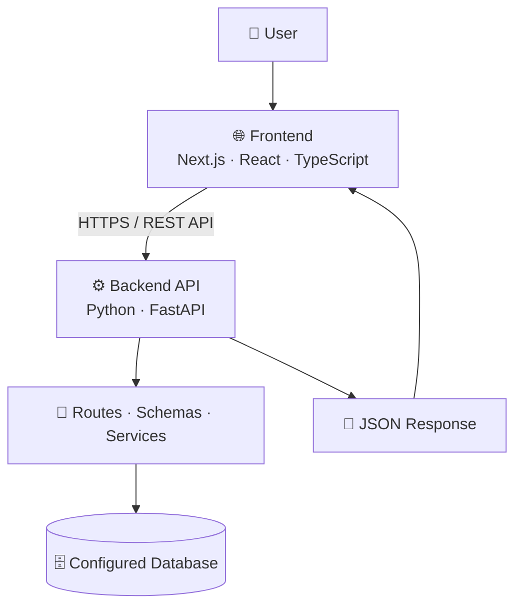

🌿 SAHAY AI
Your AI-Powered Financial & Business Companion
Democratizing Capital, Schemes & Knowledge for Small Business
An independent, multilingual platform designed to help Indian micro-entrepreneurs explore scheme information, understand eligibility workflows, organize applications, and improve their business and financial understanding.

  
  
  

🌐 Live App · ⚙️ Backend API · 📚 API Docs · 💻 GitHub Repository

📸 Homepage Demo

  

<em>Homepage screenshot supplied for the Sahay AI project README.</em>

The screenshot shows the Sahay landing page, English/Hindi/Bengali language selector, onboarding and dashboard actions, and the system-health panel.
Screenshot context: The captured panel displayed a connected backend, connected database, 413 ms latency, and a SQLite WAL (21 tables) label. These are observations from the screenshot at the time it was captured—not a guarantee of current uptime or proof of the current production database configuration.

🧭 Table of Contents
1. Project Overview
2. Mission and Vision
3. Core Principles
4. Live Demo and Resources
5. Features and Modules
6. Multilingual Experience
7. System Architecture
8. Technology Stack
9. Repository Structure
10. How the Platform Works
11. Run Locally
12. Environment Configuration
13. Testing and Quality Checks
14. Roadmap
15. Security and Responsible AI
16. Contributing
17. Disclaimer
✨ 1. Project Overview
Sahay AI is an independent software project focused on making business and financial information easier to discover, understand, and organize.
Micro-entrepreneurs and small-business owners may need to find scheme information, understand eligibility criteria, prepare documents, track applications, and make sense of business finances. Sahay aims to bring these workflows into one approachable experience with multilingual support.
The problem
- Information about schemes and financial topics can be spread across different sources.
- Eligibility requirements may be difficult to interpret.
- Application steps and document requirements can be hard to organize.
- Users may need clearer explanations in a language they understand.
The Sahay approach
Sahay combines information discovery, eligibility workflows, application organization, business-oriented tools, and AI-assisted explanations. Actual feature availability depends on the current implementation and deployed integrations.
Project detail	Description
Project name	Sahay AI
Domain	Micro-enterprise support, scheme discovery, and financial understanding
Intended audience	Indian micro-entrepreneurs and small-business owners
Supported languages	English, Hindi, and Bengali
Frontend deployment	Vercel
Backend deployment	Render
Backend framework	FastAPI
Source code	sayantandutta-18/Sahay-AI

🎯 2. Mission and Vision
<table>
  <tr>
    <td width="50%">
      <h3>🌱 Mission</h3>
      Make business and financial information easier to access, understand, and act on.
    </td>
    <td width="50%">
      <h3>🔭 Vision</h3>
      Build a trustworthy multilingual companion that helps users move from confusing information to clearer next steps.
    </td>
  </tr>
</table>

Product goals
- Make complex information easier to navigate.
- Explain eligibility outcomes in understandable language.
- Help users organize application steps and document requirements.
- Improve access through multilingual support.
- Encourage informed decisions through transparent information and calculations.
🧩 3. Core Principles
Principle	How it guides the project
✅ Accuracy first	Important scheme and financial information should be grounded in reliable sources. Uncertainty must be communicated.
🧮 Deterministic calculations	Eligibility and financial calculations should use explicit, testable rules. AI can explain a result but should not invent or override the calculation.
📚 Source-aware AI	AI assistance should rely on available evidence and encourage official verification for consequential information.
🌍 Accessibility and inclusion	The interface should be readable, responsive, and usable across supported languages.
🔐 Privacy and least privilege	Authentication, authorization, and access checks should protect private user data and documents.
🧱 Modular engineering	Routes, schemas, services, models, and UI components should have clear responsibilities.
🩺 Honest system status	Health indicators should reflect actual checks. Errors must not be disguised as successful connections.
🤝 Human in control	Sahay supports decisions; it does not guarantee approvals, returns, or outcomes.

🚀 4. Live Demo and Resources
Resource	Link	Purpose
🌐 Live frontend	Open Sahay AI	Explore the deployed interface
⚙️ Backend API	Open backend	Access the deployed API base
📚 API documentation	Swagger UI	Explore available endpoints
💻 Source code	GitHub repository	Browse code and project history

A reachable URL does not guarantee that every feature or integration is currently healthy. Check the live application for current status.

💎 5. Features and Modules
The modules below describe the product areas and their intended purpose. Treat a feature as production-ready only after its implementation and live behavior have been verified.
🏛️ Scheme Discovery
- Explore scheme-related information.
- Review important conditions and requirements.
- Identify details that must be verified against official sources.
🎯 Eligibility Evaluation
- Collect relevant user-provided information.
- Compare inputs with implemented eligibility rules.
- Explain outcomes and missing information.
- Avoid presenting an informational result as official approval.
🗂️ Application Tracker
- Organize application progress.
- Track checklists and pending steps where supported.
- Make next actions easier to review.
🔐 Document Vault and Readiness
- Organize document records and requirements.
- Identify missing items where implemented.
- Protect private documents with appropriate access controls.
💼 Business and Financial Insights
- Support review of income and expenses where implemented.
- Present understandable summaries and trends.
- Make assumptions behind calculations clear.
📈 Stock Learning and Analysis
- Support financial learning and structured analysis where available.
- Distinguish educational content from personalized investment advice.
- Never imply guaranteed returns.
🤖 AI-Assisted Companion
- Explain complex information in simpler language.
- Help users navigate available platform information.
- Communicate uncertainty rather than fabricate facts.
🛡️ Admin and Audit Workflows
- Support restricted administrative operations where implemented.
- Protect privileged routes and data.
- Maintain activity records where configured.
🩺 System Health and API Connection
- Show backend and database connectivity when checks are available.
- Help identify API, CORS, configuration, and database problems.
- Report failures honestly instead of showing a false connected state.
🌍 6. Multilingual Experience
Sahay is designed to support three languages.
Language	Locale	Experience
🇬🇧 English	en	English interface
🇮🇳 हिन्दी	hi	Hindi interface
🇮🇳 বাংলা	bn	Bengali interface

Localization goals
- Consistent language switching across supported pages.
- Translation keys kept in parity across locales.
- Appropriate Indian Rupee (INR) formatting.
- Clear and accessible wording.
A previous development run reported successful translation-key parity across en, hi, and bn, along with INR formatting checks. Re-run these checks after changes.
🏗️ 7. System Architecture
Sahay uses a frontend/backend architecture. The frontend communicates with the API over HTTP(S), while the backend handles application logic and database access.

Deployment overview
Layer	Deployment	Responsibility
Frontend	Vercel	User interface and client-side experience
Backend	Render	API endpoints and application logic
Database	Determined by backend configuration	Persistent application data

Database clarification: The supplied screenshot displayed SQLite WAL (21 tables). Confirm the current backend configuration and production environment before describing PostgreSQL or another database as the active production database.
Health checks are separate concerns
- Backend health checks whether the API responds.
- Database health checks whether the backend can reach its configured database.
- Browser connection status can also be affected by CORS, an incorrect API URL, network failures, or timeouts.
A successful frontend build does not by itself prove the live API/database integration works.
🛠️ 8. Technology Stack
Layer	Technology	Role
Frontend framework	Next.js	Application framework and routing
UI library	React	Component-based interface
Language	TypeScript	Typed frontend code
Styling	Tailwind CSS	Responsive interface styling
Backend	Python + FastAPI	API endpoints and application logic
Validation	Pydantic	Request and response validation
Testing	pytest	Backend automated tests
Frontend hosting	Vercel	Frontend deployment
Backend hosting	Render	API deployment
API explorer	Swagger UI	Interactive API documentation

Only document additional AI providers, vector databases, payment services, or external integrations as active when they are present and configured in the current codebase.
📂 9. Repository Structure
The following tree is a logical guide to the repository's main areas. Check the current repository for exact filenames before treating it as a complete file inventory.
Sahay-AI/
│
├── frontend/                         # Next.js frontend
│   ├── src/
│   │   ├── app/                      # Routes, pages and layouts
│   │   ├── components/
│   │   │   └── ui/                   # Reusable UI elements
│   │   ├── lib/                      # API client, i18n and utilities
│   │   └── types/                    # TypeScript types
│   ├── scripts/                      # Checks and helper scripts
│   ├── public/                       # Static assets
│   └── package.json                  # Frontend scripts/dependencies
│
├── backend/                          # FastAPI backend
│   ├── app/
│   │   ├── main.py                   # FastAPI entry point
│   │   ├── routes/                   # API endpoints
│   │   ├── schemas/                  # Request/response schemas
│   │   ├── models/                   # Database models
│   │   ├── services/                 # Business logic
│   │   ├── database/                 # Database session and setup
│   │   └── core/                     # Settings and security utilities
│   ├── tests/                        # Backend test suite
│   └── requirements.txt              # Python dependencies
│
├── docs/
│   └── images/
│       └── sahay-homepage.png        # README homepage screenshot
│
├── .env.example                      # Example variables, if maintained
├── .gitignore
├── render.yaml                       # Render configuration, if maintained
└── README.md
Folder responsibilities
- routes/ — endpoint definitions and HTTP behavior.
- schemas/ — input/output validation.
- models/ — database entity definitions.
- services/ — reusable business logic.
- database/ — database connectivity and session setup.
- core/ — shared configuration and security utilities.
- components/ — reusable frontend UI.
- lib/ — frontend API client, localization, and shared helpers.
- tests/ — automated checks for expected behavior.
🔄 10. How the Platform Works
1. User action: A user opens a page or submits a form.
2. API request: The frontend API client sends a request to the configured backend URL.
3. Validation: FastAPI validates the request and executes the relevant route/service logic.
4. Data access: Database-dependent operations access the configured database.
5. API response: The backend returns a structured response.
6. User feedback: The frontend displays the result or a meaningful error state.
💻 11. Run Locally
Prerequisites
- Git
- Node.js and npm
- A Python version supported by backend/requirements.txt
- A database reachable by the backend
- Environment variables required by the current codebase
Step 1 — Clone the repository
git clone https://github.com/sayantandutta-18/Sahay-AI.git
cd Sahay-AI
Step 2 — Set up the backend
Run in PowerShell from the repository root:
cd backend
python -m venv .venv
.\.venv\Scripts\Activate.ps1
python -m pip install -r requirements.txt
Configure the backend environment file using the exact variable names expected by the settings code.
If app/main.py exports a FastAPI instance named app, start the development server with:
python -m uvicorn app.main:app --reload
- API base: http://localhost:8000
- Swagger UI: http://localhost:8000/docs
Step 3 — Set up the frontend
Open a second terminal from the repository root:
cd frontend
npm install
Create frontend/.env.local using the exact API variable read by frontend/src/lib/api.ts. For example, if the client reads NEXT_PUBLIC_API_URL:
NEXT_PUBLIC_API_URL=http://localhost:8000
Start the frontend:
npm run dev
Open http://localhost:3000.
Step 4 — Verify the connection
- Confirm the backend starts without import or configuration errors.
- Confirm the frontend uses the correct API base URL.
- Confirm backend CORS permits the local frontend origin.
- Confirm the configured database is reachable.
- Test the health endpoint and a database-dependent API route.
VS Code is an editor, not a database server. A local PostgreSQL installation is not required if the backend is intentionally configured to use a reachable hosted database. The database engine and connection URL must match the actual backend setup.

🔐 12. Environment Configuration
Environment-variable names must match the current code. The examples below are illustrative; only configure variables actually used by the application.
Frontend — frontend/.env.local
For local development, if the API client reads NEXT_PUBLIC_API_URL:
NEXT_PUBLIC_API_URL=http://localhost:8000
For production, if that is the correct variable in the current code:
NEXT_PUBLIC_API_URL=https://sahay-ai-5.onrender.com
Backend — backend/.env
Illustrative examples:
DATABASE_URL=your-database-connection-string
SECRET_KEY=replace-with-a-strong-random-secret
Secret-handling rules
- Never commit .env files, passwords, API keys, JWT secrets, or access tokens.
- Configure production variables through the hosting provider's environment settings.
- Never expose backend secrets through NEXT_PUBLIC_* variables.
- Use separate development and production credentials.
- Do not commit real user documents or private financial data.
🧪 13. Testing and Quality Checks
Run commands from the repository root unless noted otherwise.
Backend tests
backend\.venv\Scripts\python.exe -m pytest backend\tests -q
Localization checks
node frontend\scripts\test-i18n.mjs
Production frontend build
cd frontend
npm run build
Previously reported development results
Check	Previously reported result
Backend automated tests	59 passed in a previous run
Translation-key parity (en, hi, bn)	Passed in a previous run
INR formatting	Passed in a previous run
Current production build	Re-run to confirm
Live frontend/backend/database integration	Verify against the current deployment

Historical results are not a guarantee that the latest code or production deployment is healthy.
🗺️ 14. Roadmap
Phase 1 — Reliability and core experience
- [ ] Verify live API and database health end-to-end.
- [ ] Test key frontend/backend user journeys.
- [ ] Improve error, timeout, loading, empty, and retry states.
- [ ] Verify authorization on protected endpoints.
- [ ] Confirm production build and deployment configuration.
Phase 2 — Scheme and application workflows
- [ ] Verify scheme details against official sources.
- [ ] Expand and test eligibility-rule coverage.
- [ ] Improve application checklists and progress tracking.
- [ ] Review document access controls and retention.
- [ ] Strengthen administrative permissions and audit coverage.
Phase 3 — Business and financial intelligence
- [ ] Expand transparent income and expense summaries.
- [ ] Develop explainable what-if simulations.
- [ ] Improve grounded AI assistance.
- [ ] Evaluate fraud indicators and false-positive behavior.
Phase 4 — Production readiness
- [ ] Complete security and privacy reviews.
- [ ] Add monitoring and error reporting.
- [ ] Validate backups and recovery procedures.
- [ ] Expand automated and end-to-end tests.
- [ ] Document deployment and incident-response processes.
🛡️ 15. Security and Responsible AI
Sahay may involve sensitive personal, document, or financial information. Security must be part of implementation—not just documentation.
- 🔐 Enforce authentication and authorization on the server.
- 🧾 Validate incoming data and return safe error messages.
- 🛡️ Restrict admin operations to authorized users.
- 📂 Apply access checks to private documents and user-owned records.
- 🔑 Keep secrets out of source control, browser bundles, and logs.
- 🏛️ Verify scheme requirements against official sources.
- 🤖 Treat AI output as assistance, not guaranteed truth.
- 🧮 Explain assumptions behind financial calculations.
- 🚨 Treat fraud signals as reasons to review, not proof of wrongdoing.
- 🧪 Test failure cases as well as successful requests.
🤝 16. Contributing
Suggestions, bug reports, and contributions are welcome.
1. Fork the repository.
2. Create a focused feature or fix branch.
3. Implement your change with clear, maintainable code.
4. Add or update relevant tests.
5. Run the applicable quality checks.
6. Open a pull request describing the change and the checks performed.
Example branch names:
feature/application-tracker
feature/financial-insights
fix/backend-health-check
test/api-integration
Please do not commit credentials, private user data, or unverified claims about production behavior.
⚠️ 17. Disclaimer
Sahay AI is an independent software project intended to support information discovery, organization, and financial understanding.
- It is not affiliated with or endorsed by any government authority.
- Scheme details, deadlines, and eligibility criteria must be verified through official sources.
- AI-generated content may contain errors or omissions.
- Eligibility evaluations are informational and do not guarantee government approval.
- Financial simulations are estimates, not guarantees.
- Investment-related information does not guarantee returns.
- Fraud indicators do not prove that a person, account, or transaction is fraudulent.
- Seek qualified professional advice for consequential financial, legal, or investment decisions.
