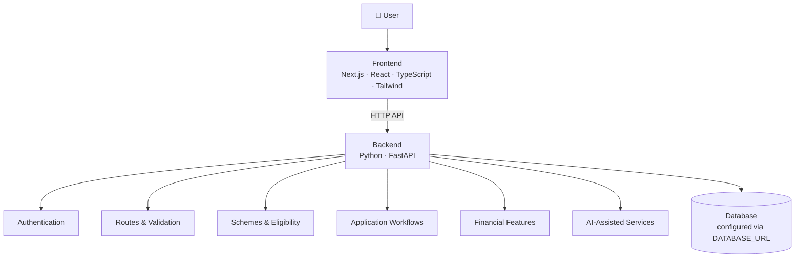

<div align="center">

# 🌿 Sahay AI

### Your AI-Powered Financial & Business Companion

*Democratizing capital, schemes and knowledge for small businesses.*

A multilingual platform that helps Indian micro-entrepreneurs explore scheme information, understand eligibility, organize applications, and make sense of their business finances.

[🌐 Live App](https://sahay-ai-beige.vercel.app/) · [⚡ Backend API](https://sahay-ai-5.onrender.com/) · [📚 API Docs](https://sahay-ai-5.onrender.com/docs) · [💻 Source Code](https://github.com/sayantandutta-18/Sahay-AI)


</div>

> 🇮🇳 **Note:** Sahay AI is an independent project. It is not an official government website and is not affiliated with, endorsed by, or operated by any government authority.

---

## 📑 Table of Contents

- [Overview](#-overview)
- [Screenshots](#-screenshots)
- [Features](#-features)
- [Multilingual Support](#-multilingual-support)
- [Design Principles](#-design-principles)
- [Architecture](#-architecture)
- [Tech Stack](#-tech-stack)
- [Repository Structure](#-repository-structure)
- [Getting Started](#-getting-started)
- [Environment Configuration](#-environment-configuration)
- [Testing](#-testing)
- [Roadmap](#-roadmap)
- [Security & Responsible AI](#-security--responsible-ai)
- [Contributing](#-contributing)
- [License](#-license)
- [Disclaimer](#-disclaimer)

---

## ✨ Overview

Small-business owners often have to navigate scattered scheme information, hard-to-read eligibility rules, document checklists, and unfamiliar financial concepts. **Sahay AI** brings these workflows into one approachable, multilingual interface with AI-assisted explanations.

**Mission:** Make business and financial information easier to access, understand, and act on.

**Vision:** A trustworthy digital companion that helps people move from scattered information to clearer next steps.

| | |
|---|---|
| **Audience** | Indian micro-entrepreneurs and small-business owners |
| **Focus** | Scheme discovery, eligibility, application tracking, financial understanding |
| **Languages** | English, Hindi, Bengali |
| **Frontend** | Next.js on Vercel |
| **Backend** | FastAPI on Render |

---

## 📸 Screenshots

<table>
  <tr>
    <td align="center" width="100%">
      <strong>🏠 Homepage</strong><br><br>
      <a href="https://sahay-ai-beige.vercel.app/">
        
      </a><br>
      <sub>Language selector, onboarding actions, and backend/database health panel.</sub>
    </td>
  </tr>
  <tr>
    <td align="center" width="100%">
      <strong>📊 Dashboard</strong><br><br>
      <br>
      <sub>Dashboard overview.</sub>
    </td>
  </tr>
</table>

> Screenshots are point-in-time captures and do not reflect current uptime or production configuration.

---

## 💎 Features

| Module | What it does |
|---|---|
| 🏛️ **Scheme Discovery** | Browse scheme information, published eligibility criteria, and commonly required documents, with reminders to verify against official sources. |
| 🎯 **Eligibility Evaluation** | Compares user-provided details against implemented rules, explains outcomes, and flags missing information. Rule-based checks stay separate from AI-generated text. |
| 📌 **Application Tracker** | Organizes application records, progress, pending steps, and checklists in one place. |
| 🔐 **Document Vault & Readiness** | Tracks document records and metadata, links them to workflows, and highlights potentially missing items. |
| 💼 **Business & Financial Insights** | Reviews income and expenses, surfaces spending patterns and possible savings, using structured, transparent calculations. |
| 📈 **Stock Learning & Analysis** | Educational content and analysis workflows. Not personalized investment advice and never a guarantee of returns. |
| 🤖 **AI Companion** | Explains complex information in plain language and helps users navigate the platform, while communicating assumptions and uncertainty. |
| 🛡️ **Admin, Audit & Health** | Restricted administrative workflows, audit visibility, and a live backend/database health panel. |

> Feature availability depends on the current implementation and configured integrations. Eligibility results are informational and do not guarantee approval or benefits.

---

## 🌍 Multilingual Support

| Language | Locale |
|---|---|
| 🇬🇧 English | `en` |
| 🇮🇳 हिन्दी | `hi` |
| 🇮🇳 বাংলা | `bn` |

Localization goals: consistent language switching, translation-key parity across all locales, clear wording, and proper Indian Rupee (INR) formatting.

---

## 🧩 Design Principles

| Principle | How it guides the project |
|---|---|
| ✅ **Accuracy first** | Ground scheme and financial information in reliable sources and communicate uncertainty. |
| 🧮 **Deterministic calculations** | Eligibility and financial arithmetic run in explicit, testable application logic. AI explains results; it never invents or overrides them. |
| 📚 **Source-aware AI** | Use available evidence and encourage official verification for consequential information. |
| 🔐 **Privacy & least privilege** | Protect private data with authentication, authorization, and access checks. |
| 🌍 **Accessibility** | Keep the interface readable, responsive, and usable in every supported language. |
| 🧱 **Modular engineering** | Routes, schemas, models, services, and UI components have clear responsibilities. |
| 🩺 **Honest system status** | Health indicators reflect real checks; errors are never disguised as success. |
| 🤝 **Human in control** | Support decisions without promising approvals, returns, or outcomes. |

---

## 🏗️ Architecture

The frontend communicates with the backend over HTTP(S). The backend handles validation, business logic, authentication, and database access.



| Layer | Deployment | Responsibility |
|---|---|---|
| Frontend | Vercel | User interface |
| Backend | Render | API endpoints and application logic |
| Database | Set by backend configuration | Persistent application data |

---

## 🛠️ Tech Stack

| Layer | Technology |
|---|---|
| Frontend framework | Next.js |
| UI library | React |
| Language | TypeScript |
| Styling | Tailwind CSS |
| Backend | Python, FastAPI |
| Validation | Pydantic |
| Testing | pytest |
| Localization | Custom i18n utilities |
| Hosting | Vercel (frontend), Render (backend) |
| API explorer | Swagger UI |
| Version control | Git & GitHub |

---

## 📂 Repository Structure

```text
Sahay-AI/
├── frontend/                  # Next.js web application
│   ├── public/                # Static assets
│   ├── scripts/               # Validation and helper scripts (e.g. i18n checks)
│   ├── src/
│   │   ├── app/               # Routes, pages and layouts
│   │   ├── components/        # Reusable UI components
│   │   │   └── ui/            # Shared UI elements
│   │   ├── lib/               # API client, i18n and utilities
│   │   └── types/             # TypeScript types
│   └── package.json
│
├── backend/                   # FastAPI service
│   ├── app/
│   │   ├── core/              # Settings and security utilities
│   │   ├── database/          # Database session and setup
│   │   ├── models/            # Database models
│   │   ├── routes/            # API route handlers
│   │   ├── schemas/           # Request/response schemas
│   │   ├── services/          # Business logic
│   │   └── main.py            # Application entry point
│   ├── tests/                 # Backend tests
│   └── requirements.txt
│
├── docs/images/               # README screenshots
├── .env.example               # Safe configuration template
├── render.yaml                # Render deployment config (if used)
└── README.md
```

> Confirm exact filenames against the current code; some optional files may differ.

---

## 🚀 Getting Started

### Prerequisites

- [Git](https://git-scm.com/)
- [Node.js](https://nodejs.org/) and npm
- Python version compatible with `backend/requirements.txt`
- A database reachable by the backend

### 1. Clone the repository

```bash
git clone https://github.com/sayantandutta-18/Sahay-AI.git
cd Sahay-AI
```

### 2. Start the backend

```powershell
cd backend
python -m venv .venv
.\.venv\Scripts\Activate.ps1      # macOS/Linux: source .venv/bin/activate
python -m pip install -r requirements.txt
```

Configure the backend environment variables (see [Environment Configuration](#-environment-configuration)), then run:

```bash
python -m uvicorn app.main:app --reload
```

- API: <http://localhost:8000>
- Swagger UI: <http://localhost:8000/docs>

### 3. Start the frontend

In a second terminal:

```bash
cd frontend
npm install
```

Create `frontend/.env.local`:

```env
NEXT_PUBLIC_API_URL=http://localhost:8000
```

```bash
npm run dev
```

Open <http://localhost:3000>.

### 4. Verify the setup

- [ ] Backend starts without import or configuration errors
- [ ] Frontend uses the correct API base URL
- [ ] Backend CORS allows the local frontend origin
- [ ] The configured database is reachable
- [ ] Health endpoint and a database-backed route respond correctly

---

## 🔐 Environment Configuration

Variable names must match the current code. Use `.env.example`, the backend settings module, and `frontend/src/lib/api.ts` as the source of truth.

**Frontend — `frontend/.env.local`**

```env
NEXT_PUBLIC_API_URL=http://localhost:8000
```

**Backend — `backend/.env`**

```env
DATABASE_URL=your-database-connection-string
SECRET_KEY=replace-with-a-long-random-secret
```

Add an AI-provider key only if the backend actually uses that provider.

**Secret-handling rules**

- Never commit `.env` files, passwords, API keys, JWT secrets, or tokens.
- Never expose backend secrets through `NEXT_PUBLIC_*` variables.
- Configure production variables in the hosting provider's dashboard.
- Use separate credentials for development and production.
- Restrict CORS to required frontend origins.

---

## 🧪 Testing

**Backend tests**

```bash
python -m pytest backend/tests -q
```

**Localization checks (translation parity and INR formatting)**

```bash
cd frontend
npm run test:i18n
```

**Production build**

```bash
cd frontend
npm run build
```

**Pre-release checklist**

- [ ] Backend tests pass
- [ ] Frontend production build succeeds
- [ ] i18n parity and INR formatting checks pass
- [ ] Frontend can reach the deployed API
- [ ] Database health and persistence verified
- [ ] Authentication and protected endpoints tested
- [ ] Loading, empty, error, and retry states behave correctly
- [ ] No secrets or private data in the repository

---

## 🗺️ Roadmap

- [ ] **Reliability:** verify live frontend/backend/database integration end to end; improve error, timeout, and retry states.
- [ ] **Schemes & applications:** validate scheme data against official sources; expand eligibility rule coverage; improve checklists and progress tracking.
- [ ] **Financial intelligence:** richer income/expense summaries, explainable what-if simulations, better grounded AI responses.
- [ ] **Security & privacy:** review authorization, document access controls, retention, and audit coverage.
- [ ] **Production readiness:** monitoring and error reporting, backup/recovery validation, broader end-to-end tests, deployment and incident documentation.
- [ ] **Localization:** keep improving English, Hindi, and Bengali quality.

---

## 🛡️ Security & Responsible AI

- Enforce authentication and authorization on the server, especially for admin routes and private documents.
- Validate all incoming data and return safe error messages.
- Keep secrets out of source control, browser bundles, and logs.
- Treat AI output as assistance, not guaranteed truth; show assumptions and uncertainty.
- Run financial arithmetic and eligibility rules in validated application logic, not in generated text.
- Treat fraud indicators as signals for review, not proof of wrongdoing.
- Do not upload sensitive documents unless the deployed service's storage and access controls have been verified.

---

## 🤝 Contributing

Bug reports, ideas, and improvements are welcome.

1. Fork the repository.
2. Create a focused branch (e.g. `feature/application-tracker`, `fix/api-health-check`).
3. Make your changes and add or update relevant tests.
4. Run the applicable checks.
5. Open a pull request describing the change and its impact.

Please avoid unrelated changes in a PR and never commit credentials or private user data.

---

## 📄 License

No license has been declared yet. Add a `LICENSE` file and update this section once you've chosen one.

---

## ⚠️ Disclaimer

Sahay AI is an independent informational and software project.

- It is not an official government platform and is not affiliated with any government authority.
- Scheme details, deadlines, and eligibility criteria must be verified through official sources.
- AI-generated content may be incomplete or incorrect.
- Eligibility evaluations are informational and do not guarantee approval or benefits.
- Financial calculations and simulations are estimates that depend on inputs and assumptions.
- Investment-related information does not guarantee returns.
- Seek qualified professional advice for consequential financial, legal, or investment decisions.

<div align="center">

**🌿 Sahay AI — Clearer information. Better-informed decisions.**

[🌐 Live Demo](https://sahay-ai-beige.vercel.app/) · [📚 API Docs](https://sahay-ai-5.onrender.com/docs) · [💻 GitHub](https://github.com/sayantandutta-18/Sahay-AI)

</div>
